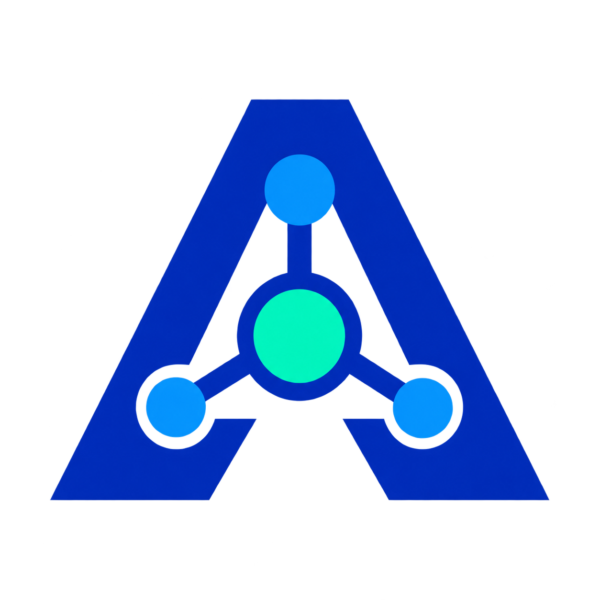

<p align="center">
  
</p>

<h1 align="center">Agent Orchestrator</h1>

<p align="center">Un centro de control local para coordinar agentes de programación, seguir sus tareas y revisar sus resultados.</p>

<p align="center">
  <a href="https://github.com/Ghost-ofc/agent-orchestrator/actions/workflows/ci.yml"></a>
  <a href="LICENSE"></a>
</p>

Agent Orchestrator conecta varios CLI de agentes con planes persistentes y un panel web en español. Puedes elegir quién coordina, asignar un agente a cada tarea o dejar que el coordinador proponga la distribución dentro de un conjunto autorizado. El historial, las preguntas, los cambios y la revisión quedan guardados localmente.

El panel permite crear proyectos y preparar flujos sin abrir una terminal para cada tarea. Los CLI deben estar instalados y autenticados previamente; el orquestador utiliza esas cuentas locales.

## Contenido

- [Qué puedes hacer](#qué-puedes-hacer)
- [Instalación](#instalación)
- [Primer flujo desde el navegador](#primer-flujo-desde-el-navegador)
- [Supervisión y resumen final](#supervisión-y-resumen-final)
- [Proyectos y carpetas](#proyectos-y-carpetas)
- [Modelos y agentes compatibles](#modelos-y-agentes-compatibles)
- [Permisos MCP y SSH](#permisos-mcp-y-ssh)
- [Servicio automático con systemd](#servicio-automático-con-systemd)
- [Uso desde el CLI](#uso-desde-el-cli)
- [Privacidad y datos locales](#privacidad-y-datos-locales)
- [Desarrollo y pruebas](#desarrollo-y-pruebas)

## Qué puedes hacer

| Función | Comportamiento |
| --- | --- |
| Panel de control | Árbol de proyectos y sesiones, lienzo de nodos e inspector de agentes y planes. |
| Flujos visuales | Selección del coordinador, objetivo, tareas y ejecutores desde el navegador. |
| Gestión de proyectos | Crear o importar carpetas, cambiar el nombre visible, archivar, restaurar y quitar proyectos del panel. |
| Seguimiento | Estados, fases, tiempo, preguntas, archivos cambiados, evidencias y consumo reportado por el proveedor. |
| Acciones | Lanzar, cancelar, responder preguntas, revisar resultados y preparar reintentos. |
| Planes persistentes | Checklist, dependencias, decisiones, contratos de tarea y estado recuperable. |
| Recursos por proyecto | Lista explícita de servidores MCP y destinos SSH permitidos, con perfiles por agente. |
| Inventario SSH | Descubrimiento pasivo, agrupación y búsqueda de hosts e identidades locales. |
| Servicio de usuario | Arranque automático del panel y reinicio ante fallos mediante `systemd`. |

La coordinación conserva el objetivo y las decisiones; cada ejecutor recibe una tarea acotada. Los procesos trabajan de forma independiente del navegador. Cerrar la pestaña no cancela los trabajos.

## Instalación

### Requisitos

- Python **3.11 o posterior** y Git.
- Codex para instalar e invocar la skill del plugin.
- Al menos un CLI de agente instalado y autenticado.
- Un navegador para utilizar el panel local.
- Opcional: Linux con `systemd` de usuario para el servicio automático.
- Opcional: XDG Desktop Portal y PyGObject en el Python del sistema para el selector nativo de carpetas en Linux.
- Opcional: OpenSSH para ejecutar comandos en destinos autorizados.

El servidor web utiliza la biblioteca estándar de Python. La interfaz usa HTML, CSS y JavaScript nativo, sin compilación de frontend, CDN ni dependencias de React.

### Como plugin de Codex

```bash
codex plugin marketplace add Ghost-ofc/agent-orchestrator
codex plugin add agent-orchestrator@agent-orchestrator
```

Reinicia Codex si la skill no aparece inmediatamente. Cada proveedor conserva su propio inicio de sesión, disponibilidad de modelos, cuotas y facturación.

### Desde el repositorio

```bash
git clone https://github.com/Ghost-ofc/agent-orchestrator.git
cd agent-orchestrator

python3 plugins/agent-orchestrator/scripts/cli_agent_job.py choices --json
python3 plugins/agent-orchestrator/scripts/cli_agent_job.py ensure-dashboard
```

`ensure-dashboard` reutiliza el panel registrado si está disponible; de lo contrario, lo inicia y abre su URL autenticada. La skill también lo invoca al comenzar una sesión de orquestación.

Para ejecutar el servidor en primer plano:

```bash
python3 plugins/agent-orchestrator/scripts/cli_agent_job.py dashboard-web --no-open --port 44509
```

`Ctrl+C` detiene ese servidor. `--port 0` solicita un puerto libre. El [servicio systemd](#servicio-automático-con-systemd) permite mantenerlo disponible automáticamente.

## Primer flujo desde el navegador

1. Crea un proyecto o importa una carpeta existente.
2. Selecciona **Nuevo flujo** y elige un CLI coordinador instalado y un modelo explícito.
3. Describe el objetivo. Puedes indicar tareas y un conjunto autorizado de ejecutores con el formato `CLI=MODELO`, uno por línea.
4. Para fijar un agente en una tarea, utiliza un prefijo como `claude-code=sonnet | Implementar el backend`. Las tareas sin prefijo quedan a criterio del coordinador dentro del conjunto autorizado.
5. El coordinador se ejecuta como un trabajo de planificación. Al terminar, abre **Revisar propuesta** y comprueba el alcance, los criterios de aceptación, la validación y las asignaciones.
6. Elige **Crear plan con estas tareas**. Desde cada tarea puedes revisar su contrato preparado y confirmar su lanzamiento.
7. Responde las preguntas del agente y registra una revisión independiente antes de aceptar el resultado.

Si no indicas ejecutores, el motor resuelve y guarda un conjunto de modelos instalados según la estrategia y el riesgo. El coordinador puede distribuir tareas dentro de ese conjunto; no puede ampliarlo por su cuenta. Las asignaciones a modelos costosos protegidos requieren autorización explícita.

**La ejecución es supervisada:** crear un flujo prepara una propuesta; aceptar el plan no lanza todas sus tareas. La aceptación requiere revisión manual o supervisión autorizada con evidencia independiente. Las propuestas inválidas y las asignaciones fuera del conjunto autorizado se rechazan.

El inspector permite consultar conversación, archivos, pruebas y consumo disponible. Un proceso terminado puede seguir **pendiente de revisión**. Cuando un proveedor no informa una métrica, se muestra como no disponible.

## Supervisión y resumen final

En **Nuevo flujo** puedes autorizar que el coordinador siga supervisando el plan después de planificarlo. El consentimiento indica que las revisiones y consultas consumen cuota del CLI/modelo elegido. Los planes anteriores conservan su funcionamiento manual hasta que actives **Supervisión y resumen**; también puedes seleccionar un revisor explícito para un plan creado sin coordinador.

El supervisor funciona en el servidor local, sin depender de una pestaña abierta, y guarda sus operaciones para recuperarse tras reinicios. Atiende tres situaciones:

- **Consultas técnicas:** el coordinador responde dentro del contrato y deja registrada su identidad. Las decisiones sobre alcance, producción, credenciales, permisos, presupuesto o autoridad insuficiente quedan para el usuario. Puedes intervenir directamente antes de su respuesta; el coordinador no sobrescribe una respuesta humana.
- **Entregas:** recibe el contrato, la línea base, el informe del agente y el contexto del repositorio. Debe revisar el diff y ejecutar comprobaciones independientes. La aceptación automática exige comandos exitosos correlacionados con eventos de herramientas del revisor; las afirmaciones de su texto final no bastan. Si el workspace cambia durante la revisión, no se acepta esa entrega automáticamente.
- **Correcciones:** si autorizas reparaciones automáticas, se reutilizan el ejecutor, perfil de recursos, presupuesto y límites de archivos originales. El motor mantiene el conjunto aprobado y el límite de tres intentos totales por tarea. Al agotar el límite, fallar un proceso o faltar evidencia, solicita intervención y evita reintentos indefinidos.

La primera ejecución de cada tarea sigue requiriendo su lanzamiento. El coordinador no inicia tareas pendientes ni amplía sus permisos. **Pausar supervisión** impide nuevas intervenciones automáticas; no cancela trabajos que ya se lanzaron.

En el detalle del plan, **Supervisión y resumen** reúne las entregas por tarea, veredictos, notas del revisor, comprobaciones ejecutadas, decisiones y pendientes humanos. El resumen indica si el plan sigue abierto o si todas sus tareas fueron aceptadas. Se guarda en `plans/<id>/supervision.json`; consultar el resumen no dispara otra llamada a un modelo.

La verificación automática de comandos está implementada para los eventos de Claude Code y Codex CLI. Otros CLI pueden analizar o responder consultas, pero no obtienen aceptación automática sin evidencia compatible. En proyectos con acceso restringido, la terminal del revisor también está restringida: si no puede ejecutar las comprobaciones, escala el caso sin relajar la política. La huella verificable requiere un repositorio Git con commit inicial; los casos sin esa línea base necesitan revisión manual.

### Notificaciones sin ruido

**Avisos**, en la cabecera, permite elegir **Solo importantes** (predeterminado), **Silenciar todas** o **Todas**. El modo predeterminado conserva avisos de intervención, bloqueos y un único cierre del plan; los resultados y revisiones individuales se consultan en el panel. Se deduplican eventos durante 24 horas y se limita cada categoría a un aviso cada 20 segundos; los pendientes siguen visibles en Atención aunque un aviso se omita por ráfaga. La preferencia se guarda en `notifications.json`. Las pruebas automatizadas utilizan `AGENT_ORCHESTRATOR_NOTIFICATIONS=off` y no deben enviar avisos al escritorio.

## Proyectos y carpetas

**Nuevo proyecto** permite crear una carpeta local, inicializar Git opcionalmente o registrar una carpeta existente. Los proyectos vacíos aparecen inmediatamente.

En Linux, **Elegir carpeta…** abre el selector del sistema mediante XDG Desktop Portal. Para crear una carpeta, **Elegir ubicación…** selecciona el directorio padre y otro campo define el nombre. Cancelar conserva la ruta escrita. Si la integración del escritorio no está disponible, puedes introducir la ruta manualmente.

Desde **Gestionar proyecto** puedes:

- Cambiar su nombre visible.
- Archivar y restaurar; **Mostrar archivados** permite recuperar la vista de proyectos archivados.
- Quitar el proyecto del panel, conservando sus archivos y su historial persistente.

Los proyectos con agentes activos no pueden archivarse ni quitarse. Volver a importar una carpeta recupera su historial y sus restricciones guardadas. El repositorio principal y sus worktrees comparten una identidad de proyecto.

### Editar un plan

Selecciona un plan y pulsa **Editar plan**. Puedes cambiar su título y objetivo, editar el título, contrato y agente de tareas sin iniciar, y añadir o quitar tareas pendientes. Las asignaciones se limitan al conjunto de ejecutores ya autorizado; editar el plan no amplía permisos ni lanza agentes.

Las tareas con ejecuciones, las completadas y sus evidencias conservan su contenido e identidad. Tampoco se pueden quitar tareas con decisiones vinculadas. Para ampliar un trabajo terminado, añade una tarea nueva; cambiar el objetivo de un plan completado requiere trabajo pendiente que lo verifique. Los contratos no se reescriben automáticamente al cambiar el objetivo.

El editor espera a que terminen los agentes y revisores del proyecto. Los proyectos archivados deben restaurarse primero. Si otra pestaña cambia el plan mientras editas, se rechaza la versión antigua y se indica cómo cargar la actual. Cada guardado conserva una copia previa del plan y su documento en `plans/<id>/revisions/`, con permisos privados.

El mismo motor permite editar por CLI mediante `edit-plan ID --input-file cambios.json --json`. El documento de cambios necesita la revisión actual, título, objetivo e ítems con sus IDs; el panel prepara ese formato automáticamente.

## Modelos y agentes compatibles

| Perfil | Selección de modelo | Observaciones |
| --- | --- | --- |
| `codex-cli` | Explícita | `codex exec`, entrada por stdin y sandbox `workspace-write`. |
| `claude-code` | Explícita | Modo no interactivo; agente interno y presupuesto cuando están disponibles. `claude` es un alias de compatibilidad. |
| `antigravity` | Explícita | Protocolo headless de `agy`, streaming JSONL, agente interno y esfuerzo de razonamiento. |
| `kimi-code` | Explícita | Admite `kimi` y `kimi-cli`, con streaming y agente interno. |
| `deepseek-harness` | Configuración del perfil | Adaptador de vista previa; su interfaz puede exponer el prompt como argumento de proceso. |
| `devin` | Explícita | Tarea desde archivo y perfil de edición del proveedor. |
| `grok` | Explícita | Tarea desde archivo; subagentes desactivados por defecto. |
| `gemini` | Explícita | Entrada por stdin y modo de edición automática. |
| `opencode` | `proveedor/modelo` | Entrada por stdin y configuración aislada; incluye modelos gratuitos disponibles en el proveedor. |
| `cursor` | Explícita | Streaming, sandbox y hook que bloquea subagentes anidados. Puede requerir confianza interactiva inicial del proyecto. |

Consulta la instalación real antes de elegir:

```bash
python3 plugins/agent-orchestrator/scripts/cli_agent_job.py choices --json
python3 plugins/agent-orchestrator/scripts/cli_agent_job.py doctor --cli all
python3 plugins/agent-orchestrator/scripts/cli_agent_job.py catalog --cli codex-cli
python3 plugins/agent-orchestrator/scripts/cli_agent_job.py catalog --cli claude-code
```

`doctor --cli all` devuelve un estado de error si falta algún CLI del catálogo; no necesitas instalarlos todos. Los modelos y controles dependen de la versión del CLI y de tu cuenta.

### Estrategia y revisión

- **`cost-first`**: prioriza el coste esperado por tarea aceptada dentro del conjunto autorizado.
- **`quality-first`**: prioriza calidad; sus autorizaciones no equivalen a habilitar cualquier modelo de máximo coste.
- **`maximum-quality`**: requiere una elección explícita de máxima calidad y coste.
- **Personalizada**: fija exactamente los pares CLI/modelo aprobados.

El motor guarda el conjunto autorizado y comprueba cada lanzamiento. La topología puede ser `auto`, `single` o `cross-harness`; el trabajo paralelo respeta dependencias, límites de equipo y un escritor por workspace. Los subagentes anidados se bloquean cuando el CLI ofrece un control fiable y se prohíben en el contrato del ejecutor.

En flujos iniciados desde Codex, el modelo actual de la conversación actúa como coordinador. `--coordinator-model` registra metadatos; no cambia el modelo de esa conversación. El panel puede lanzar otro CLI/modelo como coordinador de la propuesta.

La selección automática utiliza el catálogo versionado y el historial local de resultados revisados. No presenta sus heurísticas como puntuaciones reales de benchmarks. Consulta las reglas completas en [enrutamiento y planes](plugins/agent-orchestrator/skills/orchestrate-cli-agents/references/routing-and-plans.md).

## Permisos MCP y SSH

Abre **Gestionar proyecto → Accesos MCP / SSH** para configurar recursos permitidos.

> El modo de acceso restringido está implementado para **Claude Code en Linux**, con soporte de `--restricted`, `--strict-mcp-config`, `--tools` y configuración de sesión. El motor verifica estas capacidades y rechaza versiones, políticas o adaptadores incompatibles. No promete las mismas restricciones para otros CLI.

### Servidores MCP

El catálogo muestra los nombres de servidores encontrados en la configuración de Claude. Los seleccionados se copian a configuraciones privadas de cada trabajo. La configuración MCP estricta impide heredar servidores externos no seleccionados; una selección vacía no carga MCP externos.

El catálogo no envía al navegador variables de entorno ni cabeceras de autorización de esos servidores. Autorizar un MCP implica confiar en sus herramientas y en sus permisos propios.

### Destinos SSH

Cada destino autorizado incluye alias, host/IP, usuario, puerto y ruta de una identidad existente. El agente recibe `ssh_exec` sobre esos alias, sin argumentos SSH arbitrarios.

El broker utiliza OpenSSH con una configuración independiente: host keys existentes verificadas estrictamente, autenticación no interactiva, identidad seleccionada y sin heredar proxies, comandos de configuración ni reenvíos de agente, X11 o puertos. No se copian los contenidos de las claves al panel. Los comandos tienen límites de tiempo y salida; la auditoría registra las conexiones sin copiar el texto del comando.

Una lista vacía no expone destinos SSH.

### Inventario y grupos

El inventario lee de forma pasiva `~/.ssh/config` y los `Include` compatibles. Muestra alias, usuarios, puertos y rutas de identidad; comprueba la existencia de archivos mediante metadatos. No abre claves privadas, ejecuta `Match exec` ni realiza conexiones SSH.

Los `Include` se limitan a archivos llamados `config` o terminados en `.conf`. Las configuraciones dinámicas, proxies y opciones no soportadas requieren revisión manual. Los candidatos encontrados por nombre, extensión o archivo `.pub` asociado no se consideran claves verificadas criptográficamente.

Puedes buscar por host, grupo, usuario o identidad. **Organizar este host** permite asignar grupo y entorno: desarrollo, pruebas, producción o sin clasificar. También se señalan cuentas `root`, identidades compartidas y candidatos sin host asociado.

**Agrupar, importar o actualizar el inventario no concede acceso.** Las etiquetas son globales para el inventario y no modifican `~/.ssh/config` ni mueven archivos.

### Perfiles por agente

Activa **Asignar recursos mediante perfiles de agente** y crea subconjuntos como `backend` o `revision`. Cada perfil solo puede utilizar MCP y destinos SSH autorizados previamente para el proyecto.

Elige el perfil por separado para el coordinador y cada ejecutor. Desde el CLI utiliza `--access-profile backend`. El inspector muestra el perfil aplicado y los recursos efectivos.

Con este control activo, un agente sin perfil recibe **cero MCP externos y cero destinos SSH**, incluso si eliminas el último perfil. Desactivar el control restaura explícitamente la herencia de recursos del proyecto.

### Alcance de la restricción

Los trabajadores restringidos conservan herramientas nativas de archivos, pero no una terminal general, ejecución arbitraria de código, navegación web ni subagentes. El MCP interno `ao_control` transporta fases y preguntas. Las comprobaciones que requieren terminal necesitan un MCP de confianza o un revisor independiente.

Las reglas de archivos protegen `~/.ssh`, la configuración de autenticación, el estado privado y las identidades del proyecto. Los permisos no se aplican retroactivamente: no se pueden cambiar mientras haya agentes activos, y el trabajador verifica que la política no haya cambiado antes de arrancar.

Esta es una frontera de herramientas del CLI, **no un sandbox del sistema operativo ni un firewall**. Los MCP autorizados y las cuentas remotas conservan sus permisos. Las sesiones ejecutadas fuera de este motor no reciben estas restricciones.

## Servicio automático con systemd

La unidad de ejemplo está en [deploy/systemd/agent-orchestrator.service](deploy/systemd/agent-orchestrator.service). Supone que el repositorio está en `~/Proyectos/agent-orchestrator`; ajusta `WorkingDirectory`, `ExecStart` y `PATH` a tu instalación.

Detén primero cualquier panel independiente que esté usando el mismo puerto. Después:

```bash
mkdir -p ~/.config/systemd/user
cp deploy/systemd/agent-orchestrator.service ~/.config/systemd/user/
systemctl --user daemon-reload
systemctl --user enable --now agent-orchestrator.service
```

La unidad inicia el panel en `http://127.0.0.1:44509`, no abre el navegador y reinicia el proceso ante fallos. Está configurada para detener solo el panel y conservar los trabajadores independientes.

```bash
systemctl --user status agent-orchestrator
systemctl --user restart agent-orchestrator
systemctl --user stop agent-orchestrator
journalctl --user -u agent-orchestrator -n 50
```

Para abrir la URL autenticada del servicio:

```bash
python3 plugins/agent-orchestrator/scripts/cli_agent_job.py ensure-dashboard
```

El servicio conserva su token privado en `dashboard-service-token.json` con permisos `0600`; las pestañas siguen autenticadas después de reiniciarlo. El modo en primer plano genera un token nuevo en cada arranque.

Una unidad de usuario habilitada arranca con el gestor de usuario. Para que funcione desde el arranque del equipo sin iniciar sesión, habilita *lingering* si la política de tu sistema lo permite:

```bash
loginctl enable-linger "$USER"
```

La elección de carpetas requiere una sesión gráfica disponible, aunque el servicio pueda arrancar antes.

## Uso desde el CLI

Desde la raíz del repositorio, puedes definir un atajo para esta sesión:

```bash
ao() { python3 plugins/agent-orchestrator/scripts/cli_agent_job.py "$@"; }
ao --help
```

### Crear un plan y lanzar una tarea

```bash
ao create-plan \
  --title 'Mejorar autenticación' \
  --workspace /ruta/al/proyecto \
  --plan-file /ruta/al/plan.md \
  --executor 'claude-code=sonnet' \
  --json

ao launch \
  --cli claude-code \
  --model sonnet \
  --plan-id ID_DEL_PLAN \
  --checklist-item item-001 \
  --workspace /ruta/al/proyecto \
  --task-file /ruta/a/tarea.md \
  --json
```

El contrato de tarea debe incluir objetivo, justificación, alcance, archivos, instrucciones, restricciones, criterios de aceptación, validación e informe final. Sus encabezados técnicos se conservan en inglés para el validador. Consulta [el formato del contrato](plugins/agent-orchestrator/skills/orchestrate-cli-agents/references/task-contract.md).

### Revisar y aceptar

```bash
ao record-review ID_DEL_TRABAJO \
  --verdict accepted \
  --reviewer current-codex-task \
  --test 'Pruebas relevantes: correctas' \
  --notes-file /ruta/a/revision.md \
  --json
```

Registra evidencia de comprobaciones que hayas ejecutado realmente. `accepted` completa el ítem vinculado; `repair_required` mantiene el trabajo pendiente y `rejected` lo bloquea. Las dependencias esperan a que sus predecesores sean aceptados.

### Preguntas y decisiones

```bash
ao request-feedback \
  --workspace /ruta/al/proyecto \
  --question '¿Qué alcance debe cubrir la siguiente tarea?' \
  --json

ao feedback --workspace /ruta/al/proyecto --all --json
ao answer-feedback ID_DEL_FEEDBACK --file respuesta.md --json
```

Los trabajadores también pueden emitir preguntas desde su canal de trabajo. El panel las muestra y guarda las respuestas sin reiniciar el agente. Las respuestas duplicadas no sobrescriben una decisión ya guardada.

### Aislamiento del workspace

```bash
# Preferir worktrees aislados.
ao preferences --workspace-mode worktree

# Trabajar en el checkout actual para futuras orquestaciones.
ao preferences --workspace-mode project
```

La preferencia persiste localmente. El modo de proyecto conserva bloqueos de escritura, línea base de cambios, límites de alcance y revisión.

### Añadir otro CLI

Los adaptadores personalizados se definen en `~/.config/agent-orchestrator/agents.json`. Utilizan arrays de argumentos ejecutados directamente, sin interpolación de shell. El esquema y sus controles se describen en [configuración de adaptadores](plugins/agent-orchestrator/skills/orchestrate-cli-agents/references/adapter-config.md).

## Privacidad y datos locales

El estado se guarda por defecto en `~/.codex/agent-orchestrator/`. Puedes cambiarlo mediante `AGENT_ORCHESTRATOR_HOME`.

| Archivo o carpeta | Contenido |
| --- | --- |
| `jobs/` | Trabajos, resultados, canales, preguntas, logs y revisiones. |
| `plans/` | Planes, checklist y decisiones. |
| `feedback/` | Consultas del coordinador y respuestas persistentes. |
| `projects.json` | Registro de proyectos y políticas de acceso. |
| `ssh-inventory-groups.json` | Etiquetas globales de hosts y entornos. |
| `dashboard.json` | Registro del panel activo y URL autenticada. |
| `dashboard-service-token.json` | Token persistente del servicio. |

Estos datos no forman parte del repositorio. No publiques las URL autenticadas, tokens, logs privados ni configuraciones con credenciales.

El panel escucha exclusivamente en `127.0.0.1`. Cada petición API exige un token, y se comprueban `Host` y `Origin`. La URL inicial transporta el token en su fragmento; el navegador lo retira de la barra y lo conserva en el almacenamiento de la pestaña. El servidor utiliza CSP, bloqueo de iframes, respuestas sin caché, rutas estáticas explícitas y límites de tamaño de solicitudes.

La interfaz no carga assets externos ni telemetría. Los agentes y los MCP autorizados pueden comunicarse con sus propios proveedores. El panel es una herramienta local de usuario; no debe exponerse mediante un proxy público ni considerarse aislado de otros procesos de la misma cuenta.

Después de aceptar un trabajo, la limpieza conserva planes, historial y evidencias. No elimina recursos de propiedad incierta ni archivos del usuario.

## Desarrollo y pruebas

```bash
python3 -m unittest discover -s plugins/agent-orchestrator/tests -v
python3 -m compileall -q plugins/agent-orchestrator/scripts
python3 -m json.tool .agents/plugins/marketplace.json >/dev/null
python3 -m json.tool plugins/agent-orchestrator/.codex-plugin/plugin.json >/dev/null
node --check plugins/agent-orchestrator/web/app.js
node --check plugins/agent-orchestrator/web/actions.js
node --check plugins/agent-orchestrator/web/i18n.js
```

Node solo es necesario para estas comprobaciones de sintaxis; el panel no lo requiere en ejecución. Las pruebas automatizadas utilizan estado temporal y proveedores simulados para comprobar el motor, la API, los proyectos, los flujos, el inventario y las políticas sin consumir cuotas reales ni conectarse por SSH.

Las comprobaciones visuales deben cubrir escritorio, un viewport de 390 px, navegación por teclado, movimiento reducido y consola sin errores. La integración con el selector de carpetas requiere además un escritorio Linux compatible.

Para contribuir, consulta [CONTRIBUTING.md](CONTRIBUTING.md) y [SECURITY.md](SECURITY.md). El proyecto parte de [Augani/agent-orchestrator](https://github.com/Augani/agent-orchestrator).

## Licencia

[MIT](LICENSE).
